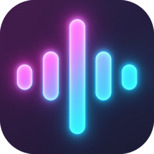
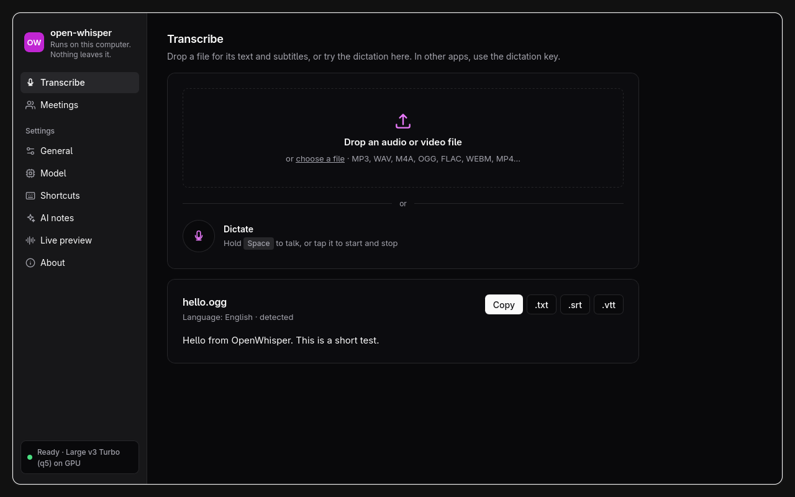
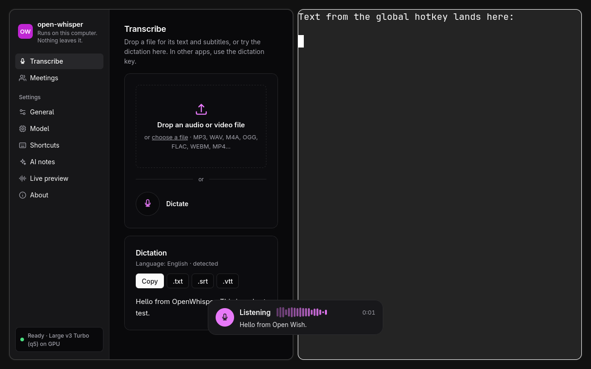
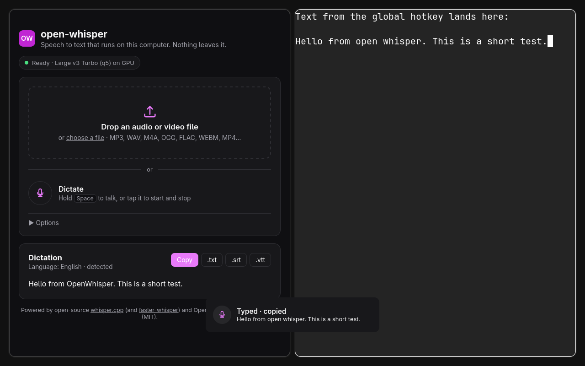
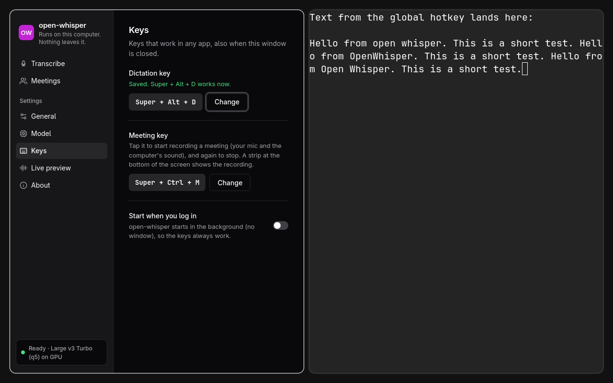

# Lowkey

Local speech to text as a desktop app. Drop an audio or video file and get the text, hold
a key and talk into any app, or record a meeting as text next to your notes. Everything runs on your computer with open-source software and
open model weights. No account, no API key, no cloud, unless you choose one: a provider such as
OpenAI, Anthropic, Groq or Deepgram can transcribe or write the notes in its place
([AI providers](#ai-providers-optional)).

It is one native program (Rust + Tauri v2) with whisper.cpp inside: on the GPU through Vulkan
(Linux, Windows) or Metal (macOS), else on the CPU.



**It was called open-whisper before.** The first start of Lowkey moves your settings
(`~/.config/open-whisper` → `~/.config/lowkey`), your data (models, meetings, history:
`~/.local/share/open-whisper` → `~/.local/share/lowkey`) and the Start at login entry. An old
app that still runs is asked to quit first. A Hyprland block with the old markers
(`open-whisper.dictation`) still works. `make install-desktop` removes the old program and
launcher entry.

## Download

Installers for Linux (AppImage, .deb, .rpm), Windows (.exe, .msi) and macOS on Apple Silicon
(.dmg) are on the repository's **Releases** page, one release per version. They are not signed:
Windows SmartScreen asks once (More info → Run anyway); on macOS run
`xattr -dr com.apple.quarantine /Applications/Lowkey.app` after copying the app. Each push
also leaves them as artifacts of its run (Actions → the run → Artifacts, kept 90 days).

**Make a release:** set the version in `desktop/src-tauri/tauri.conf.json` and `Cargo.toml`,
commit with `[release]` in the message, then `git tag v<version>` and push the tag and the
branch. The tag's run builds the three systems and creates the release (a tag that does not
match the version fails).

## Install from source

**You need** Rust (`rustup`), Node.js 20+, and on Linux the WebKitGTK 4.1, GTK 3,
libappindicator, Vulkan loader and `glslc` packages (Omarchy has them). `make desktop` fetches
the Vulkan and SPIR-V headers into `desktop/.deps` if your system does not have them.

```sh
make install-desktop     # builds the app and copies it to ~/.local/bin/lowkey
lowkey                   # start it
```

The first start downloads the speech model (0.55 GB) and the live preview model (17 MB), once.
The window shows the progress. Other builds:

```sh
make desktop             # only build: desktop/src-tauri/target/release/lowkey
                         # (also fetches the checked sherpa-onnx libraries into desktop/.deps)
make desktop-bundle      # AppImage / .deb / .rpm in desktop/src-tauri/target/release/bundle/
make desktop-windows     # Windows x64 lowkey.exe, built on Linux:
                         # desktop/src-tauri/target/x86_64-pc-windows-msvc/release/lowkey.exe
```

`make desktop-windows` needs `cargo-xwin` (`cargo install --locked cargo-xwin`) and clang/llvm.
The first time, it downloads the Microsoft C runtime and Windows SDK (~1.2 GB, into
`~/.cache/cargo-xwin`; cargo-xwin accepts Microsoft's license for you). It uses the system's
`ninja` and `lld-link`, or else puts ninja (from PyPI) and Rust's `rust-lld` into
`desktop/.deps`. It makes the program only, with no installer, and the speech model runs on
the CPU. Windows must have the Visual C++ runtime (`MSVCP140.dll`). The installers come from CI
(see Download).

## Use

- **File:** drop a file on the window, or click to choose one. It starts at once. MP3, WAV,
  M4A, OGG, FLAC, WEBM, MP4, MOV, MKV and most other audio/video formats work (with `ffmpeg`
  installed for Opus, WebM and most video). Other files get a clear error message.
- **Dictation in the window:** hold <kbd>Space</kbd> while you talk, then release. Or tap
  <kbd>Space</kbd> once to start and again to stop. The mic button does the same.
  <kbd>Esc</kbd> cancels. A live waveform shows that the app is listening.
- **Result:** the text appears while it is transcribed. **Copy** puts it on the clipboard.
  **.txt**, **.srt** and **.vtt** save the transcript or subtitles.
- **The window** has sections on the left: **Transcribe** (files, dictation in the window, the
  result; it opens there), **Meetings** (below), **History**, and the settings, sorted by task —
  General (start at login, appearance), Speech (microphone, language, vocabulary, the speech
  model and free memory when idle, or a provider in the cloud), Dictation (the dictation key, the paste key, live preview),
  Meetings (the meeting key, call detection, screen video, who is speaking, the notes model and
  automatic notes; a provider in the cloud for the notes), Connections (note apps, AI agents), About (also a list of the keys).
  Each model shows its status next to its setting.
  <kbd>Ctrl</kbd>+<kbd>,</kbd> jumps to the settings, <kbd>Esc</kbd> back to Transcribe.
- Files given on the command line open in the app. **Closing the window keeps the app
  running** in the tray, so the dictation key stays instant. Quit with **Exit** at the bottom
  of the side menu, from the tray, or with `lowkey --dictate quit`. While a meeting records,
  Exit asks first, then stops and saves the meeting before it quits. While the app is still at
  work (telling the voices apart, writing notes, answering a question, transcribing files),
  Exit lists that work and asks: **Quit when done** (it quits by itself after), **Quit now**
  (that work stops: Write notes writes the notes later), or **Keep running**.
  `lowkey --dictate quit` quits at once.
- **Appearance** (Settings → General): System (follows the desktop's light or dark setting),
  Light or Dark. The recording strip stays dark.
- **The tray icon's menu:** Open, Start/Stop dictation (the text goes to the app that has the
  focus), Start/Stop meeting recording, **Microphone** (the system default or one input),
  **Speech-to-text model** (Automatic or one model; a model that is not on disk downloads when
  you choose it), Exit. The menu follows the app: it says Stop while a
  recording runs, and it shows a microphone when you plug it in.

## Dictate into any app

The global key is **<kbd>Super</kbd>+<kbd>Ctrl</kbd>+<kbd>X</kbd>** on Linux and
**<kbd>Ctrl</kbd>+<kbd>Alt</kbd>+<kbd>Space</kbd>** on macOS and Windows.

- **Hold** the key while you talk, then release. Or **tap** it to start and tap again to stop.
- A small window at the bottom of the screen shows a live waveform and, while you talk, the
  words it hears (**live preview**). It never takes the keyboard focus.
- The text is **typed into the app that has focus** and is also **copied to the clipboard**.
- Dictations follow on: if you start talking again soon after the last text was typed (the
  new recording ends at most **15 seconds** after it) and the same window has focus, the new
  text is typed with a space in front ("…a test. And then…"), unless it starts with `.`, `,`,
  `;`, `:`, `!`, `?`, `…`, `%` or a closing bracket or quote. After a longer pause, or in
  another window, no space is added. The clipboard always gets the text alone.
- **The key also works when the app is closed:** it starts the app in the background (no
  window), the overlay shows "Getting ready…", and the dictation begins when the model is
  ready. Keep holding the key for push-to-talk, or let go and tap it again to finish.
- While a dictation is still being transcribed, a new press shows "Still transcribing".
  Dictation goes ahead of files in the queue.
- **Move or collapse the strip** (the dictation and the meeting recording use the same window):
  drag it anywhere on the screen. The button in its top-right corner (it shows when the
  pointer is on the strip) makes it a small pill with the dot and the time. A click on the pill
  opens it again. The app keeps the place and the size for the next time
  (`overlay_at`, `overlay_collapsed` in the settings). While a meeting records, the window is a
  small **capsule** (see Meetings), whatever the strip's size: on hover its **microphone
  button** mutes your microphone (silence is recorded in its place; the computer's sound goes
  on) until you click it again. The strip never keeps the keyboard focus:
  on Hyprland a click focuses a window, so the app gives the focus back to your app at once
  (during a drag, when you let go).





**Hyprland (0.56+, Lua config): no setup.** The app adds the key and the overlay window rule
to the running Hyprland with `hyprctl eval`, and again when Hyprland reloads its config. No
config file is changed. To keep the key after a logout (and to start the closed app), put it in
your config: `lowkey --print-snippet lua` prints the lines; add them to
`~/.config/hypr/bindings.lua` between `-- BEGIN lowkey.dictation` and
`-- END lowkey.dictation`. A block that runs `scripts/ow-dictate` (from earlier versions)
keeps working: the script hands the key to the app, or starts `~/.local/bin/lowkey`
(else this folder's build; `OPENWHISPER_DESKTOP_BIN` overrides) with its output in
`$XDG_RUNTIME_DIR/lowkey/app.log`. When the key is in your config, the app
sees it and does not add it again. Classic `hyprland.conf`: `--print-snippet conf`.

- **Change the key in Settings → Dictation → Change**, then press the new combination
  (Super, Ctrl or Alt with a letter, digit, F1-F24 or Space; Esc cancels). It works at once,
  and the app refuses a combination that another shortcut uses. When the key comes from a
  block in your Hyprland config, Settings offer **"Let the app manage it"**: the block is
  removed (a backup is kept next to the file), Hyprland reloads, and the app checks that its
  key works; if not, your config is put back. It also turns on "Start at login" (the config's
  bind worked after a logout; the app's bind needs the app).
- **Settings → General → Start when you log in**: the app starts hidden at login, so the key
  works all the time (Linux: `~/.config/autostart/lowkey.desktop`).
- Command line: `--hotkey "…"` (this run), `hotkey = "…"` in the settings, `--no-hotkey` adds
  none; `--remove-hotkey` removes a key that the app added (never yours).
- Title-bar plugins (hyprbars, as in Omarchy's window controls) skip the overlay: its rule
  turns the bar off when the plugin is loaded.
- It needs `wl-copy` and `wtype` (typing on Wayland). The microphone is recorded by the app
  itself, and only while the overlay shows "Listening".
- A line break in the text is typed as <kbd>Shift</kbd>+<kbd>Enter</kbd>, never as Enter: in
  Slack, Teams or a web chat, Enter sends the message, and the rest of a long dictation would go
  into a new one. Shift+Enter starts a new line there and in editors (in some terminals it acts
  as Enter). A tab is typed as a space (a tab moves the focus). The clipboard keeps the text as it is.
- **X11, macOS, Windows:** the app registers the key while it runs. Typing uses xdotool (X11)
  or the system API (macOS asks once for Accessibility permission). Not tested on this
  machine.
- **GNOME, KDE, sway (Wayland):** apps cannot add keys there. Bind `lowkey --dictate
  press` / `--dictate release` (or `--dictate toggle`) in the desktop's keyboard settings.

### Live preview

While you hold the key, the overlay shows the words as you say them; the main model still
writes the text that is typed. Two engines (Settings → Dictation → Live preview → Preview engine):

- **Parakeet** (the default when its model is on disk): more accurate, 25 languages, about
  1.1 GB of memory. When Parakeet is also the main model, both share one copy.
- **Whistle** ([Cactus](https://huggingface.co/Cactus-Compute/whistle), 17 MB, CPU): light;
  English, German, French, Spanish, Italian, Dutch and Polish.

Turn the preview off in Settings (`live_preview = false`). Details and measurements:
[docs/live-preview.md](docs/live-preview.md).

## Meetings

Record a call or a talk, as text next to your notes (Linux for now). No bot joins the call.

- **The meeting key** (<kbd>Super</kbd>+<kbd>Ctrl</kbd>+<kbd>M</kbd> on Linux,
  <kbd>Ctrl</kbd>+<kbd>Alt</kbd>+<kbd>M</kbd> on macOS and Windows; change it in Settings → Meetings)
  starts a recording from any app, and stops it. On Hyprland (or with your own desktop bind)
  it also starts the app when it is closed; on X11, macOS and Windows the app must run. A
  small capsule at the bottom of the screen shows a red dot, Lowkey's mark and the time. The
  mark's bars move with the voices, green while you talk and blue while the others talk. On
  hover the capsule shows **Record screen**, **Mute** and **Stop**; a click elsewhere on it
  opens the meeting in the window. At Stop it says "Saving", then **Open the notes**: a click
  opens the window on that meeting's notes. The saved capsule stays 8 s, and longer while the
  pointer is on it. It never keeps the keyboard focus; drag it to move it.
- **Record** (in the window, next to the search field) does the same, and so does the tray menu. It records two sources: your microphone (**Me**) and the computer's sound
  (**Them**: the others in Zoom, Meet, Teams…, through PipeWire or PulseAudio).
- The text comes a few seconds after someone speaks: each source is cut at pauses (4–20 s
  pieces) and the speech model chosen in Settings → Speech writes them.
- **Stop** transcribes the last seconds and saves. The list shows all meetings, newest first,
  grouped by day; open one to read it (the notes, or the transcript in their place with the
  **Notes | Transcript** switch; the chat on the right), change the title, **Copy** or
  **Export .md** (the notes, then the transcript).
- **Check a point of the notes:** click it (or <kbd>Enter</kbd> on it) to see, under it, the
  transcript's paragraphs it most likely comes from (speaker, time, the shared words marked);
  **Show in transcript** opens the transcript at that paragraph. A point that no paragraph
  matches says so: check it, the notes are a draft.
- **Fix the transcript:** in a saved meeting, click a paragraph (or Enter on it) to correct the
  model's words; <kbd>Enter</kbd> or a click outside saves, <kbd>Esc</kbd> cancels, and the
  speaker label switches the speaker (Me, then each speaker). An empty paragraph is removed. A fix that looks
  like a name or a term ("Lisando" → "Lisandro") offers to add it to the Vocabulary, so the
  model writes it right next time. Copy, Export, search, the note-app file and AI agents use
  the fixed text; the notes stay as written, with **Write notes again** for the fixed text.
- **Who is speaking** (Linux x86_64; Settings → Meetings → Who is speaking, off by default):
  after Stop, the others in the call are told apart by their voices, and each "Them" line gets
  a speaker: **Speaker 1**, **Speaker 2**… Click a speaker to type a name; give two speakers the
  same name when they are one person, and their lines merge. Copy, Export, the note-app file,
  the notes and AI agents use the names. Notes written already change with the name ("Speaker
  2" becomes the name in them); they do not need to be written again for it. Turning it on downloads two models (46 MB). While a
  meeting records, the computer's sound is kept in a temporary file in the meetings folder;
  after Stop it takes about 2 minutes for an hour of meeting, then the file is deleted, and only
  then are the note-app file and the notes written (Export, Write notes and fixes wait for
  it). If the app quits or crashes first (also while the meeting records), the file is kept and
  the next start tells the voices apart, then writes the note-app file and the notes (the
  notes only if the meeting has none). That is its last try: if it is stopped again, the file
  is deleted at the following start and the meeting keeps "Them" (never a crash at every
  start). Meetings over 3 hours keep "Them". On two test meetings, 89% of the speech
  time went to the right person (54% with one label for all). Voices that are alike, people
  who talk at the same time, and a person who says little are the usual errors.
  Details: [docs/voices.md](docs/voices.md).
- **Screen video** (Linux): during a meeting, **Record screen** (in the meeting's live panel,
  or the screen button on the strip) saves the screen, or one window, as a video with the
  meeting; **Stop screen** stops it, and the meeting goes on. Record it as often as you want:
  each time is one more video of the meeting. In a saved meeting the video is on the left, with
  the chat under it, and the notes and the transcript are on the right (one column on a narrow
  window). A click on a paragraph of the transcript moves the video to that moment (a double
  click fixes the text); each time in the transcript plays it from there; a place under a point
  of the notes has **Play**. While the video plays, or when you move it, the paragraph said at
  that moment is marked and kept in view. The first time, your desktop asks what to share; it
  then remembers it (Settings → Meetings → Screen video → **Choose the screen again** asks
  again). 10 frames a second, at most 1920 pixels wide, about 450 MB for one hour. It needs
  GStreamer: `gst-plugins-good` (VP8 on the CPU), and `gst-plugin-va` for AV1, VP9 or H.264 on
  the GPU; Settings says what it found. Details: [docs/screen.md](docs/screen.md).
- **Search** (<kbd>Ctrl</kbd>+<kbd>F</kbd> on the list): the meetings that have every word you
  type, in any order and any case, also inside a word, in the title, the transcript, the
  notes or your notes. Each result shows where the words are and the text around them, with
  the words marked. <kbd>Esc</kbd> clears the search.
- **Delete** a meeting from the list (the bin icon at the end of its row, on hover or with
  <kbd>Tab</kbd>) or from the open meeting. A dialog asks first (Cancel has the focus).
- **Notes**: a language model writes the meeting's notes from your notes and the transcript,
  organized like the meeting: one section for each topic, with a bullet for each decision, fact,
  figure or task (the person in bold), and sub-bullets for the details. Each bullet ends with its
  time in the transcript, e.g. (12:40), and the app puts the bullets and the sections in the
  order of the meeting by these times. Built in:
  **Qwen3.5 4B** (Apache-2.0), run by llama.cpp on this computer (a 2.7 GB download the first
  time; ~25 s for 8 minutes of meeting on the Radeon 780M, ~1 min on a CPU). Settings → Meetings →
  Notes also offers Qwen3.5 2B (1.3 GB, faster, less exact) and Gemma 4 E4B (5 GB). Or your own
  server in Settings → Meetings → Notes (Ollama, LM Studio, any OpenAI-compatible API; a warning shows
  when it is not on this computer), or a provider in the cloud: OpenAI, Anthropic, OpenRouter,
  Vercel AI Gateway, Groq, Gemini or Mistral ([AI providers](#ai-providers-optional)). They are
  written by themselves when a meeting stops (the
  first time, after the model's download), or with **Write notes** when a meeting has none.
  **Regenerate** writes them again (it asks first; the new notes replace the old ones only when
  they are complete, so a failed or cancelled try keeps them). They are a draft, and
  Copy/Export include them. **Instructions for the notes** (Settings → Meetings → Notes) shows
  what the model is told: change it to try other notes, and **Restore the original** brings
  back the app's instructions. `{language}` becomes the meeting's language (when the text does
  not have it, "Write in …" is added at the end), and the Vocabulary's names are added. Measurements: [bench/summary/results.md](bench/summary/results.md).
- **Ask about this meeting** (the chat on the right; <kbd>Ctrl</kbd>+<kbd>K</kbd>): the same
  model answers questions from the transcript and the notes ("who calls Acme?", "write a
  follow-up email"). Three suggestions are ready: a follow-up email, a TL;DR, your tasks. The
  questions and answers are saved with the meeting (**Clear** deletes them); search and the
  export do not include them. <kbd>Enter</kbd> asks, <kbd>Shift</kbd>+<kbd>Enter</kbd> starts a
  new line, and the button stops an answer.
- **Calls are detected** (Linux; Settings → Meetings → Offer to record calls, on by default): when Zoom,
  Teams, Slack, Discord, Signal… or a browser on Google Meet, Teams, Jitsi… uses the
  microphone for 2 s (an unknown browser page: 20 s), the strip says "Zoom call detected ·
  Super+Ctrl+M records it", for 20 s. The meeting key then records it as "Zoom call". Per call:
  **Ask**, **Always record** (starts by itself, and stops by itself when the call ends) or
  **Never**. The same call is not offered again until it has been off the microphone for 60 s;
  3 s off it, the strip says the call ended. Who uses the microphone comes from PipeWire
  (`pactl`), a browser's page from its Hyprland window title. (Idea from
  [Hex](https://github.com/anomalyco/hex), MIT.)
- Use headphones. Without them the microphone also hears the others; the app removes a "Me"
  line when most of its words are in a "Them" line at the same time.
- Tell the others that you record. Meetings are saved as JSON in
  `~/.local/share/lowkey/meetings` (a private folder). The audio is not kept (with Who is
  speaking on, the computer's sound only until the voices are told apart after Stop). The
  screen videos, when you record the screen, are kept next to the meeting and deleted with it.
- macOS and Windows record the microphone only, for now.

Details: [docs/meetings.md](docs/meetings.md).

## Microphone

Settings → Speech → Microphone: the system default or any input, with a line that says which
one is in use and why, and **Test** (a level meter for 4 s). On Linux the list is the
PipeWire/PulseAudio sources (`pactl`), and the app records the exact source through PipeWire.
**Use another microphone instead of a Bluetooth headset** (on by default, Linux): with the
system default, a Bluetooth headset's microphone would switch the headset to call mode (mono,
poor sound for everything else), so the first other real microphone is used; a virtual source
(a noise filter) is never chosen for you, only by you. A saved microphone that is not
connected falls back to the default. macOS and Windows choose by device name (cpal), with no
Bluetooth detection yet. (Idea from [Hex](https://github.com/anomalyco/hex), MIT.)

## History

The **History** section keeps every finished dictation (the global key and the window), newest
first, grouped by day: Copy, Delete, and Clear all (a dialog asks first). **Search**
(<kbd>Ctrl</kbd>+<kbd>F</kbd>) looks in the text of the dictations only (not the date or the
app): every word you type must be there, in any order and any case, also inside a word
("frid ship" finds "Ship the new version on Friday"); the words are marked in the results. **Keep**: off, 1 day, 7 days (default),
30 days or forever; turning it off deletes what was kept. The file is
`~/.local/share/lowkey/history.json` (0600). **Paste last dictation**
(<kbd>Super</kbd>+<kbd>Alt</kbd>+<kbd>V</kbd> on Linux, <kbd>Ctrl</kbd>+<kbd>Alt</kbd>+<kbd>V</kbd>
elsewhere; Settings → Dictation) types the last dictation again into the app you are in, also
with the history off; with the app closed it reads the last one from the file. (Ideas from
[Hex](https://github.com/anomalyco/hex), MIT.)

## Vocabulary

Settings → Speech → Vocabulary: names and terms the model gets wrong (people, projects,
products), each with "sounds like" spellings. In every transcript (dictation, files,
meetings) those spellings, and the term in another case, become the term, whole words only.
Whisper also gets the terms as a prompt, so it spells them right more often; the AI notes get
them too. Parakeet has no prompt: there only the replacement helps. (Idea from
[Hex](https://github.com/anomalyco/hex), MIT.)

```toml
[[vocabulary]]
term = "Lisandro"
sounds_like = ["Lisando", "Lee Sandro"]
```

Whisper's prompt is tokenized in Rust (`whisper_tokens.rs`): whisper.cpp's own tokenizer
aborts in this binary ("free(): invalid pointer"), because the static sherpa-onnx library
brings another build of libstdc++'s `std::regex` and the linker keeps one copy for both
(confirmed: a build without Parakeet does not abort).

## Note apps

Settings → Connections → Note apps: each meeting as a Markdown note in a folder you choose. Nothing leaves the
computer; the folder decides where the notes go:

- **Obsidian:** your vault, or a folder in it. The meeting then has **Open in Obsidian**.
- **Logseq:** its `pages` folder.
- **Google Drive, Dropbox, iCloud Drive, Syncthing:** a folder that their app keeps in sync.

A note is saved by itself when a meeting stops, and again when its AI notes are written (or with
**Save to folder** in the meeting). It is named `2026-11-04 14.05 Weekly sync.md`, follows a new
title, and starts with front matter:

```yaml
---
title: "Weekly sync"
date: 2026-11-04T14:05:00-03:00
duration_min: 32
tags: [meeting]
lowkey_id: m-1793800000000
---
```

Then the parts you chose: AI notes, your notes, the transcript. A note you changed in the other
app is never overwritten: the app keeps a hash of what it wrote, and says so instead.

## AI providers (optional)

Settings → Speech → **Where it runs**: on this computer (the default), or a provider that
transcribes: **OpenAI**, **OpenRouter**, **Groq**, **Mistral**, **Deepgram**, **ElevenLabs**, or your own
OpenAI-compatible server (Speaches, LocalAI…). Settings → Meetings → Notes → **Notes model**: the
built-in model, your own server, or **OpenAI**, **Anthropic**, **OpenRouter**, **Vercel AI
Gateway**, **Groq**, **Google Gemini** or **Mistral** for the notes and the chat.

- Type the provider's API key once; Speech and Notes share it. It stays in config.toml (0600) and
  never goes to the page. With the key saved, Settings checks it and lists the provider's models.
- Your audio (Speech) or the transcript (Notes) then goes to that provider: Settings says so in
  orange. Silence is never sent (Silero VAD checks first). The live preview still runs here.
- Long files go in 10-minute pieces; a busy server or the network is tried again 3 times.
- AI agents (`lowkey --mcp`) and `lowkey --transcribe` always use the model on this computer.

Details, the defaults and how the times come back: [docs/providers.md](docs/providers.md).

## AI agents (MCP)

Claude Code, Codex, Gemini CLI, Cursor and other agents can use Lowkey over the
[Model Context Protocol](https://modelcontextprotocol.io): `lowkey --mcp` serves it on stdin and
stdout. The agent starts it when it needs it; the app does not have to run. Settings → Connections → AI agents
has the line for each agent, with your path, and a Copy button:

```sh
claude mcp add -s user lowkey -- /usr/bin/lowkey --mcp
codex mcp add lowkey -- /usr/bin/lowkey --mcp
gemini mcp add -s user lowkey /usr/bin/lowkey --mcp
```

Other agents: `{"mcpServers": {"lowkey": {"command": "/usr/bin/lowkey", "args": ["--mcp"]}}}`.

| Tool | What it does |
|---|---|
| `list_meetings` | The meetings, newest first: id, title, start (UTC), length |
| `get_meeting` | One meeting as Markdown: AI notes, your notes, transcript ("Me" is you); `parts` picks some |
| `search` | Meetings and dictations with every word of the query; where in a meeting it was found |
| `get_action_items` | The tasks in the AI notes (`- **Ana** sends…`), by owner and topic |
| `last_dictation` | The last dictation in the history |
| `transcribe_file` | An audio or video file through the local model (absolute path) |
| `recording_status` | Whether the app runs and records a meeting now |
| `start_meeting`, `stop_meeting` | Record a meeting; **only** with Settings → Connections → AI agents → "Let agents start and stop recordings" (`mcp_recording = true`; off by default) |

Meetings are MCP resources too (`lowkey://meeting/<id>`). The server only reads the app's files
(never writes them), never downloads a model (`transcribe_file` uses the downloaded ones) and
opens no network port. When an agent starts or stops a recording, the
strip shows it as always and a notification says that an agent did it. An agent sends what it
reads to its own AI service: Lowkey itself sends nothing.

## Settings (all optional)

Settings in the window save them to `~/.config/lowkey/config.toml`:

```toml
model = "large-v3-turbo-q5_0"   # empty or missing: the default for this machine
language = "auto"
idle_unload_minutes = 15        # free the model's memory after 15 idle minutes; 0 = never
hotkey = "SUPER + CTRL + X"
meeting_hotkey = "SUPER + CTRL + M"   # start/stop a meeting recording; "" = no key
paste_hotkey = "SUPER + ALT + V"      # type the last dictation again; "" = no key
theme = "system"                # the window's colours: system | light | dark
history_keep = "week"           # off | day | week | month | forever
microphone = ""                 # "" = system default; else a PipeWire source / device name
avoid_bluetooth_mic = true      # with the default: not a Bluetooth headset's microphone
call_detection = true           # offer to record when a call app uses the microphone (Linux)

[call_policies]                 # per call: ask (default) | always | never
zoom = "always"
ai_engine = "builtin"           # AI notes: builtin | server (a provider: ai_provider)
ai_builtin_model = "qwen3.5-4b" # qwen3.5-4b (recommended) | qwen3.5-2b | gemma-4-e4b
ai_provider = "custom"          # custom (your own server) | openai | anthropic | openrouter | vercel | groq | gemini | mistral
ai_url = "http://localhost:11434/v1"   # your own notes server (OpenAI-compatible)
ai_model = ""                   # "" = the provider's default model
speech_provider = ""            # "" = the model here | openai | groq | mistral | deepgram | elevenlabs | custom
speech_model = ""               # "" = the provider's default model
speech_url = "http://localhost:8000/v1"   # your own speech server (OpenAI-compatible)
ai_auto = true                  # write AI notes when a meeting stops
ai_prompt = ""                  # the instructions for the notes ("" = the app's; Settings → Meetings → Notes)
export_dir = ""                  # Note apps: the folder for each meeting's Markdown note ("" = off)
export_auto = true              # save there when a meeting stops and when its AI notes are written
export_parts = ["ai_notes", "notes", "transcript"]
mcp_recording = false           # AI agents (lowkey --mcp) may start and stop recordings
meeting_voices = false          # Who is speaking: tell the others apart by voice after Stop
screen_token = ""               # the screen chosen last time (the portal's token); "" = ask
live_preview = true             # words in the overlay while you talk
overlay_collapsed = false       # the strip as a small pill (its corner button; a click opens it)
# overlay_at = [0.5, 0.9]       # where you left the strip (fractions of the screen's free room)
preview_engine = "auto"         # auto (Parakeet when on disk, else Whistle) | whistle | parakeet

[api_keys]                      # one key per provider (docs/providers.md); never sent to the page
openai = "sk-…"
```

A model that the app no longer has (the faster-whisper `fw:` models) falls back to the
default. Command line: `--model <id>` (overrides the file), `--language <code>`, `--hotkey "…"`,
`--no-hotkey` (no global keys), `--background`, `--meeting toggle|start|stop` (`--title <text>` with start), `--paste-last`, `--transcribe <file>` (prints JSON, no window), `--mcp` (AI agents),
`--print-snippet [lua|conf]`, `--remove-hotkey`, `--dictate press|release|toggle|cancel|quit`.

## Models

The Whisper models run in whisper.cpp, Parakeet in sherpa-onnx (onnxruntime, CPU). Numbers are from the development machine (Ryzen 7 H 255,
Radeon 780M; [docs/tauri-desktop-options.md](docs/tauri-desktop-options.md)):

| Model | Download | GPU (Vulkan) | CPU only | WER | Notes |
|---|---|---|---|---|---|
| large-v3-turbo-q5_0 | 0.55 GB | 10.9× real time | 1.4× | 3.2% | **default with a GPU** |
| large-v3-turbo | 1.6 GB | 8.9× | 1.3× | 3.9% | |
| medium | 1.5 GB | 6.6× | 1.7× | 3.2% | |
| small | 0.47 GB | 17.6× | 5.6× | 12.7% | **default without a GPU** |
| parakeet-v3 | 0.67 GB | — | **35.9×** | 14.3%* | NVIDIA Parakeet (CPU, 25 languages): a 3 s dictation in 0.14 s instead of 1.56 s |

\*Parakeet: 0–5.7% on four of the five clips, 49% on the extreme-noise English one; in Spanish
it makes 2–4× more errors than the default. Details: [docs/parakeet.md](docs/parakeet.md).

A model that is not on disk downloads the first time you use it, into
`~/.local/share/lowkey/models`. Silero VAD drops silence, so silent audio gives no text.

Who is speaking (meetings) uses two more models, 46 MB, in `models/voices`: pyannote
segmentation 3.0 and NVIDIA TitaNet-S, run by sherpa-onnx on the CPU.

## How it works

`desktop/src-tauri/src/` (Rust):

- `engine.rs` loads one model at a time (download with progress, idle unload) and runs
  whisper.cpp with VAD (threshold 0.3) and beam size 5. A `cloud:<provider>/<model>` id goes to
  `cloud_stt.rs` instead; `providers.rs` lists the providers, their APIs and default models. `jobs.rs` is a queue with one worker;
  dictation goes first.
- `mic.rs` records the microphone (cpal); `dictation.rs` is the global key's state machine;
  `output.rs` types and copies the text; `hyprland.rs` adds the key and the overlay rule.
- `preview.rs` runs the live preview (Whistle) on its own thread.
- `meeting.rs` records a meeting: it cuts each source at pauses, sends the pieces to the model,
  drops echoes and saves the meeting; `system_audio.rs` records the computer's sound.
- `app.rs` has the windows, the tray, the commands for the page and the single instance (a
  second launch hands its command or file to the running app); `tray.rs` describes the tray
  menu from the app's state.

`frontend/` (Vite + TypeScript) has the window's page (`index.html`, `src/main.ts`) and the
overlay (`overlay.html`, `src/overlay.ts`).

## Develop

```sh
make desktop-dev   # the app with hot reload (Vite + tauri dev)
make test          # UI typecheck + build, Rust unit tests
make e2e-desktop   # the app in a nested Hyprland, on a temporary headless output of your
                   # session; its own runtime folder and a D-Bus that starts no services (no
                   # portals): files, errors, dictation, the global key, live preview, Settings,
                   # a meeting; the meeting key and its capsule (drag, mute, stop, record
                   # screen, Open the notes), AI notes (with a cached Qwen3.5 4B in bench/.work/llm);
                   # screenshots 09-40. Programs it started are stopped at the end.
                   # python3 scripts/e2e_desktop.py --strip-only: only the capsule (quick)
                   # python3 scripts/e2e_desktop.py --first-run: empty model folder
                   # OW_E2E_HYPRBARS=<hyprbars.so>: also checks that title-bar plugins skip the overlay
make bench         # research only: the model benchmark (docs/benchmark.md), Python via uv
```

The real preview engine test: `cd desktop/src-tauri && cargo test --lib real_whistle -- --ignored`.
The real screen portal test (it opens your desktop's screen picker):
`cd desktop/src-tauri && cargo test --lib real_portal -- --ignored --nocapture`.
Dependencies are pinned in `desktop/src-tauri/Cargo.lock` and `frontend/package-lock.json`.

## Privacy

Audio, transcripts and screen videos stay on your computer, unless you point AI notes to a server that is
not on it (Settings says so), or connect an AI agent (it sends what it reads to its own service). The only other network access is the one-time model
download from Hugging Face (and the llama.cpp runner from GitHub for AI notes) (the live preview engine and model, and the voice models,
come from pinned revisions, checked with SHA-256; that engine has no network code).

## Licenses

- [whisper.cpp](https://github.com/ggml-org/whisper.cpp) (MIT), Whisper model weights by
  OpenAI (MIT), Silero VAD (MIT).
- Parakeet: [NVIDIA Parakeet TDT 0.6B v3](https://huggingface.co/nvidia/parakeet-tdt-0.6b-v3)
  weights (CC-BY-4.0), run with [sherpa-onnx](https://github.com/k2-fsa/sherpa-onnx)
  (Apache-2.0) and onnxruntime (MIT).
- Who is speaking: [pyannote segmentation 3.0](https://huggingface.co/pyannote/segmentation-3.0)
  (MIT) and [NVIDIA TitaNet-S](https://catalog.ngc.nvidia.com/orgs/nvidia/teams/nemo/models/titanet_small)
  (NeMo toolkit licence, Apache-2.0), sherpa-onnx exports.
- Live preview: [Cactus Whistle and the needle engine](https://huggingface.co/Cactus-Compute/whistle)
  (Apache-2.0).
- Tauri, Vite and TypeScript are open source (MIT/Apache).
- Benchmark only: [faster-whisper](https://github.com/SYSTRAN/faster-whisper) (MIT) and
  [Piper](https://github.com/rhasspy/piper) TTS (MIT).
