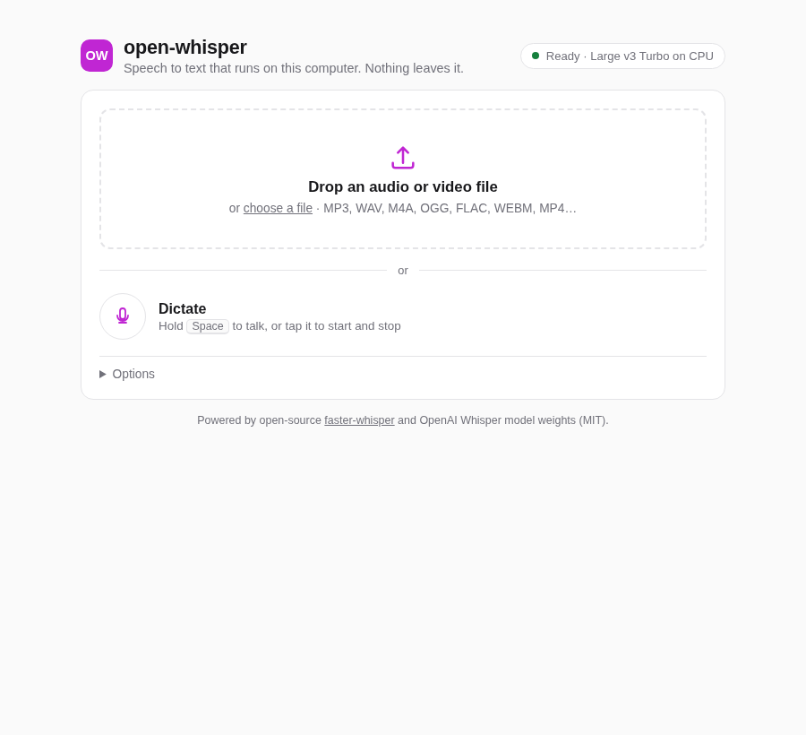
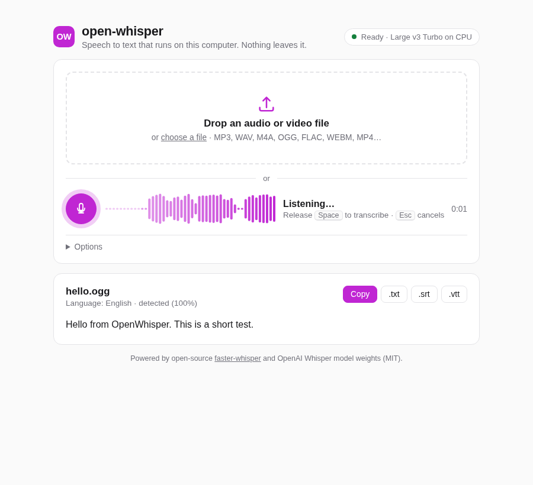
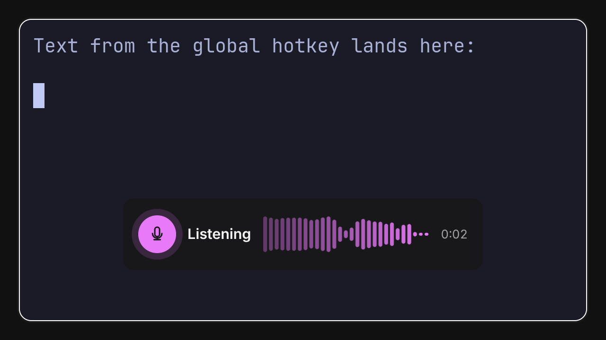
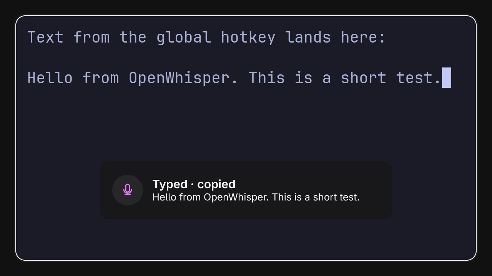

# open-whisper

Local speech to text in your browser. Drop an audio or video file and get the text,
or hold <kbd>Space</kbd> and talk. Everything runs on your computer with open-source
software and open model weights. No account, no API key, no cloud.



## Start

```sh
./run
```

That is all. The first run:

1. installs the Python dependencies (uv also fetches Python 3.12 if needed),
2. builds the web UI,
3. opens <http://127.0.0.1:8000> in your browser (the next free port if 8000 is taken),
4. downloads the speech model (about 1.5 GB, once). You see the progress in the terminal
   and at the top of the page.

Later runs start in a few seconds. Stop with <kbd>Ctrl</kbd>+<kbd>C</kbd>.
`make run` does the same.

**You need:** [uv](https://docs.astral.sh/uv/getting-started/installation/),
Node.js 20+ (only when the UI needs building: the first run, or after its sources change), and an internet connection for the
first model download. You do not need ffmpeg: audio is decoded with PyAV, which bundles
the ffmpeg libraries.

## Use

- **File:** drop a file on the page, or click to choose one. It starts at once.
  MP3, WAV, M4A, OGG, FLAC, WEBM, MP4, MOV, MKV and most other audio/video formats work.
  Other files get a clear error message.
- **Dictation:** hold <kbd>Space</kbd> while you talk, then release. Or tap
  <kbd>Space</kbd> once to start and again to stop. The mic button does the same.
  <kbd>Esc</kbd> cancels. A live waveform shows that the app is listening.
  The browser asks for microphone permission the first time.
- **Result:** the text appears while it is transcribed. **Copy** puts it on the
  clipboard. **.txt**, **.srt** and **.vtt** download the transcript or subtitles.
- **Options** (collapsed, never required): force a language instead of auto-detect,
  or pick another model. Your choice is remembered in the browser.



## Dictate into any app (Hyprland)

On Hyprland, open-whisper also adds a **global key: <kbd>Super</kbd>+<kbd>Ctrl</kbd>+<kbd>X</kbd>**
(Omarchy's dictation key). It works in every app, not only in the browser:

- **Hold** the key while you talk, then release. Or **tap** it to start and tap again to stop.
- A small window at the bottom of the screen shows a live waveform while it listens. It never
  takes the keyboard focus.
- The text is **typed into the app that has focus** and is also **copied to the clipboard**.
- Dictations follow on: if you dictate again within **15 seconds** into the same window, the
  new text is typed with a space in front ("…a test. And then…"), unless it starts with
  punctuation. After a longer pause, or in another window, no space is added. The clipboard
  always gets the text alone.




**Setup: none** on Hyprland 0.56+ with a Lua config (as Omarchy has). `./run` adds the key
and the overlay window rule to the running Hyprland with `hyprctl eval`, and adds them again if
Hyprland reloads its config while open-whisper runs. No config file is changed.

**The key also works when open-whisper is closed.** The key stays after open-whisper stops.
Press it, and open-whisper starts in the background (no browser tab); the overlay shows
"Getting ready…" with the start-up or first-run download progress, and the dictation begins
as soon as the model is ready. Keep holding the key for push-to-talk, or let go and tap it
again to finish. The first press after open-whisper was closed takes a few seconds (no
window shows until the app can draw the overlay); later presses are instant, because the app
keeps running in the background. Stop it with `scripts/ow-dictate quit` (running `./run`
while it runs just opens it in the browser).

The key lasts until you log out, or until Hyprland reloads its config while open-whisper is
not running (an Omarchy theme or settings change does that). After that, start `./run` once,
or keep the key in your config (below). If you move or delete this folder, the old key points
nowhere; remove it with `hyprctl eval 'hl.unbind("SUPER + CTRL + X")'`.

The terminal shows the result, for example:

```
  Global dictation key: SUPER + CTRL + X — hold to talk, tap to start/stop (also starts open-whisper when it is closed)
```

- While a dictation is still being transcribed, a new press shows "Still transcribing" in the
  overlay. Dictation goes ahead of file uploads in the queue.
- If the key is already in use, open-whisper does not take it and tells you. Choose another
  key: `./run --hotkey "SUPER + ALT + D"`. Turn the key off with `./run --no-hotkey`, or remove
  it at once with `uv run python -m openwhisper.hotkey --remove`.
- It needs PipeWire (`pw-record`), `wl-copy`, `wtype` and Chromium (or Chrome/Brave) for the
  overlay. Omarchy has all of them.
- The overlay is a separate browser profile in `~/.local/state/open-whisper/overlay-browser`
  that only opens this local page. The microphone is recorded by open-whisper itself, and
  only while the overlay shows "Listening".
- Only `scripts/ow-dictate` can start a dictation: it sends a random token that open-whisper
  writes to your private runtime folder. Web pages and other users on the computer cannot.
- If a start fails, a desktop notification points to the log
  (`$XDG_RUNTIME_DIR/open-whisper/app.log`).

**Optional: keep the key in your Hyprland config.** Then the key is there after every login
and config reload, and it starts open-whisper when it is not running.
Print the snippet for this folder and add it to `~/.config/hypr/bindings.lua` yourself:

```sh
uv run python -m openwhisper.hotkey      # prints the Lua lines to add
```

It is two binds (press and release) that run `scripts/ow-dictate`, plus the overlay window
rule. When the key is in your config, open-whisper sees it and does not add it again, and
`--no-hotkey` / `--remove` leave it alone (they only remove keys that the app added).

**Classic `hyprland.conf` (no Lua):** open-whisper cannot add the key itself. Print the two
bind lines with `uv run python -m openwhisper.hotkey --conf` and add them to your config.
Typing and the clipboard work; the overlay window stays off, because without its window rule
it could take the keyboard focus (you get desktop notifications for errors instead).

**Other desktops** (sway, GNOME, KDE…): bind `scripts/ow-dictate toggle` to a key (one press
starts, the next stops), or `ow-dictate press` / `ow-dictate release` if your desktop has
release binds. Text output works on any Wayland desktop with `wl-copy` and `wtype`; the
overlay window placement is Hyprland-only.

## Models

The default is **large-v3-turbo** (int8 on CPU). It was the best quality for its
speed in a benchmark on the development machine (Ryzen 7 H 255, no GPU); see
[docs/benchmark.md](docs/benchmark.md). Other models are in **Options**:

| Model | Download | Speed here | WER here | Notes |
|---|---|---|---|---|
| small | ~0.5 GB | 8.9× real time | 13.6% | fastest; weak on noisy audio |
| medium | ~1.5 GB | 3.3× | 4.2% | |
| large-v3-turbo | ~1.5 GB | 4.0× | 4.2% | **default** |
| large-v3 | ~3 GB | 2.2× | 2.3% | most accurate, needs ~3 GB RAM |

On a CPU, a short dictation takes about 3.5 s to transcribe with auto-detect. open-whisper
runs the Whisper encoder once for both language detection and transcription (stock
faster-whisper runs it twice; see [docs/benchmark.md](docs/benchmark.md)).

A model that is not on disk downloads the first time you use it.
Models are stored in the normal Hugging Face cache (`~/.cache/huggingface/hub`).

**Hardware:** with an NVIDIA GPU and CUDA libraries, the app uses the GPU (float16)
automatically. Otherwise it uses the CPU with int8 quantization.

To change the built-in default for everyone, edit `DEFAULT_MODEL` in
[`openwhisper/config.py`](openwhisper/config.py).

## How it works

```
browser (Vite + TypeScript)          Python (FastAPI, 127.0.0.1 only)
  drop file / MediaRecorder  --POST /api/transcribe-->  probe with PyAV, queue job
  EventSource  <--SSE /api/jobs/{id}/events--  one worker thread runs faster-whisper,
  live text + progress                         streams segments as they are decoded
```

- `openwhisper/engine.py` downloads models with byte progress, loads one model at a time,
  runs faster-whisper with VAD (threshold 0.3, tuned in the benchmark) and beam size 5.
- `openwhisper/jobs.py` is an in-memory queue with one worker, so jobs do not fight
  for the CPU. Uploads are temporary files, deleted after the job.
- `openwhisper/server.py` has the API and serves `frontend/dist`.
- `frontend/src/` has the page: `main.ts` (UI), `dictation.ts` (microphone),
  `waveform.ts` (live waveform).

### API

| Method | Path | |
|---|---|---|
| GET | `/api/status` | device, default model, per-model download state and progress |
| GET | `/api/languages` | language codes |
| POST | `/api/transcribe` | multipart `file`, optional `language` (`auto`), optional `model`. Returns `job_id` |
| GET | `/api/jobs/{id}` | job state, progress, `new_segments` (all so far) + `segment_count`, `result` (`text`, `segments`, `srt`, `vtt`) when done |
| GET | `/api/jobs/{id}/events` | the same as Server-Sent Events |

## Develop

```sh
make dev       # backend with reload on :8000 + Vite dev server on :5173
make test      # backend tests (fake engine, generated audio) + frontend typecheck/build
make test-all  # + a real-model test on a 3-second TTS clip
make e2e       # headless Chromium with a fake microphone: file, error and dictation flows,
               # writes docs/screenshots/. Uses the system chromium; without one, run
               # `uv run playwright install chromium` once
make e2e-hotkey  # global key in a nested Hyprland (your session is not touched): overlay,
                 # typing, clipboard, hold and tap, key starts the closed app; screenshots 06-08.
                 # Options: --first-run (empty model cache: shows the download),
                 # --config-bind (key from the bindings.lua snippet: no duplicate binds)
make bench     # model benchmark on this machine -> bench/.work/results.md
```

Dependencies are pinned in `uv.lock` and `frontend/package-lock.json`.

## Privacy

Audio and transcripts stay on your computer. The only network access is the one-time
model download from Hugging Face.

## Licenses

- [faster-whisper](https://github.com/SYSTRAN/faster-whisper) (MIT),
  [CTranslate2](https://github.com/OpenNMT/CTranslate2) (MIT),
  Whisper model weights by OpenAI (MIT).
- FastAPI, Uvicorn, PyAV, Vite and TypeScript are open source (MIT/BSD/Apache).
- Benchmark only: [Piper](https://github.com/rhasspy/piper) TTS (MIT) and
  [whisper.cpp](https://github.com/ggml-org/whisper.cpp) (MIT).
