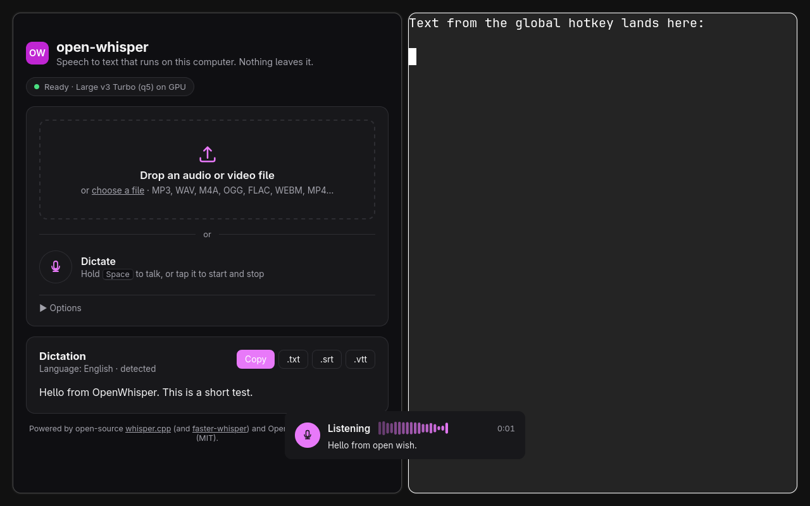

# Live preview in the dictation overlay (Cactus Whistle)

Status: built on branch `feat/tauri-desktop` (desktop app only), decided by Franco on
2026-11-01 ("option 1").

While you hold the dictation key, the overlay shows the words as you say them. The text that
is typed and copied still comes from the main model (default whisper.cpp
`large-v3-turbo-q5_0`, WER 3.2%). The preview only shows that the app hears you.

## What runs

| Part | What | Size | Source (pinned) |
|---|---|---|---|
| Model | `whistle.cact`, 2–4-bit, 7 languages | 16.9 MB | `Cactus-Compute/whistle` @ `74111868`, SHA-256 `b6e02f04…` |
| Engine | `libneedle3.so` (C API `needle.h`, libc++ inside, only libc/libm/pthread needed) | 1.6 MB | from `cactus_needle-3.3.3-py3-none-manylinux2014_x86_64.whl` in `Cactus-Compute/needle3` @ `d6c7d6a2`, SHA-256 of the wheel `b909897e…` and of the library `87476ff7…` |

- Both files are downloaded once at app start into
  `~/.local/share/open-whisper/models/whistle/` (or `$OPENWHISPER_MODELS_DIR/whistle`). The
  checksums are checked at every start: a wrong or truncated file (or a new pin in the code)
  is deleted and downloaded again. If the download fails, the preview is off until the next
  start, or until it is turned off and on again in Options.
- On a system without an engine build, nothing is downloaded.
- The app loads the library at run time (`libloading`). The engine is process-global and not
  thread-safe, so one worker thread ("whistle") owns it.
- No Python and no telemetry: the telemetry of Cactus lives in their Python package only. The
  C library has no socket, DNS or HTTP symbols (`nm -u`), and no URLs in its strings.
- Not used: the static `libneedle.a`. It needs libc++ at link time, which most Linux systems
  do not have, and it would make the build depend on it.
- Only Linux x86-64 (glibc) for now. Upstream has macOS and Windows builds too; they are not
  wired in because they cannot be tested on this machine. On other systems there is no
  preview, and dictation works the same.

## How it works

1. The recorder sends the mic samples (device rate, ~0.5 s blocks) to the worker while it
   records, and the last block when it stops.
2. The worker resamples to 16 kHz and calls `needle_stream_transcribe_process` with about one
   second of audio. Audio that queues up during a pass is fed in one call, so the preview does
   not fall behind on a slow CPU; it only updates less often.
3. Each pass returns the words that two passes agree on (committed) and an unconfirmed tail.
   The overlay shows committed + tail: the newest words that fit on one line.
4. When the key is released, `needle_stream_transcribe_stop` gives the last words; they show
   (grey) while the main model works. Then the typed text replaces the preview.
5. Cancel, an error, or a too-short recording throw the stream away. Late text from an old
   stream cannot reach a newer recording (epoch check).

Language: the language from Options (or `--language`) is passed to Whistle when it is one of
its 7 (en, de, fr, es, it, nl, pl). With another language there is no preview. With "auto"
Whistle detects the language itself (best effort).

The same change also makes the global key use the language from Options for the final
text. Before, only in-window dictation did.

## Measurements (this machine: Ryzen 7 H 255, CPU only)

Accuracy on the benchmark clips (`bench/.work/samples`, the WER method of
`docs/benchmark.md`). Streaming in 1 s chunks gives about the same result as one pass:

| Clip | One pass | Stream, 1 s chunks | Language fixed (stream) |
|---|---|---|---|
| en_tts (clean) | 5.5% | 5.5% | 5.5% |
| en_tts_noisy | 34.2% | 42.5% | 42.5% |
| es_tts (clean) | 17.1% | 14.3% | 14.3% |
| es_tts_noisy | 38.6% | 34.3% | 34.3% |
| en_jfk (real speech) | 0.0% | 0.0% | 0.0% |

For comparison, the main model: 3.2% over all clips. That is why the preview never writes the
final text.

Speed and load: a pass takes 14–70 ms for the first seconds and grows with the buffered audio
to about 1.1 s at worst; the engine trims its window, and the time drops back (70 s stream:
max 1.08 s per pass). The CPU load is about 3.5 cores while you talk. Memory: about 76 MB
while the app runs (the engine has no unload call; turning the preview off stops its use, and
the memory is freed at the next start).

## What the Whistle best-practices article changes here

From <https://cactuscompute.com/blog/whistle-best-practices>, checked on our clips:

- **Set the language up front.** Done when Options has one of the 7 languages. On our clips it
  made no difference (the detection was already correct), but it removes detection errors on
  the first, very short passes.
- **Keyword biasing** (names, rare words; 100-word list: B-WER 18.4% → 4.5% on LibriSpeech).
  It fixes only the listed words: our clip errors are common words (salt→soul,
  nights→knights, horno→orno), which a list does not fix. Listing "Hello" fixed "Low from open
  whisper" → "Hello from open whisper", which shows the effect but is not a real use. A user
  vocabulary (keywords for Whistle and the whisper prompt for the main model) is a possible
  later feature; it is not built.
- **Decoder depth** (2–8 layers): the C API has no setting for it; the engine uses the full
  decoder (best WER).

## Tests

- Rust unit tests (`make test-desktop`): the mic's audio blocks for the preview (0.5 s, the
  rest at stop), a wrong cached file is deleted, zip reading (stored and deflated, written by hand in
  the test), checksum, engine JSON, the worker (1 s passes, tail on stop, a dropped stream is
  discarded, a new stream starts clean and closes a stream left open, late audio of an old
  stream is ignored, no stream when not ready or for an unsupported
  language), and dictation (preview while listening and transcribing, never typed, discarded
  on cancel and on a too-short recording, the key uses the language from Options).
- Real engine (`cargo test --lib real_whistle -- --ignored --nocapture`): downloads the pinned
  files into the models folder, streams the JFK clip, checks the text.
- `make e2e-desktop` (nested Hyprland): the engine becomes ready, words reach the overlay
  while the key is held (screenshot 18), the typed text is the main model's text, and the
  preview is gone after typing. The first run downloads the engine and keeps a copy in
  `bench/.work/whistle`; later runs work offline. Without network and without that copy, the
  preview checks are skipped (with a SKIP line) and the rest must still pass.
